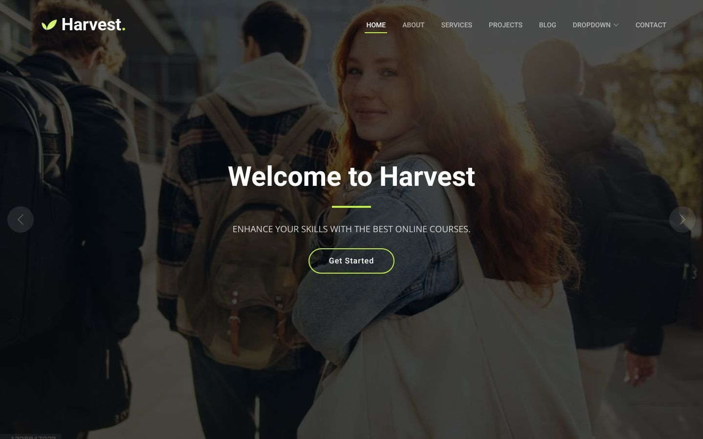
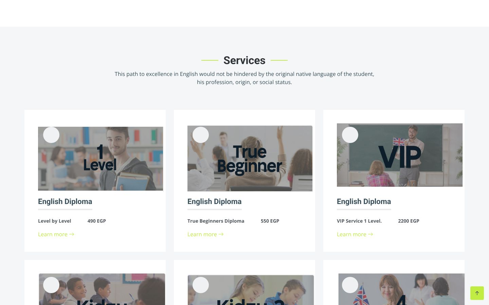
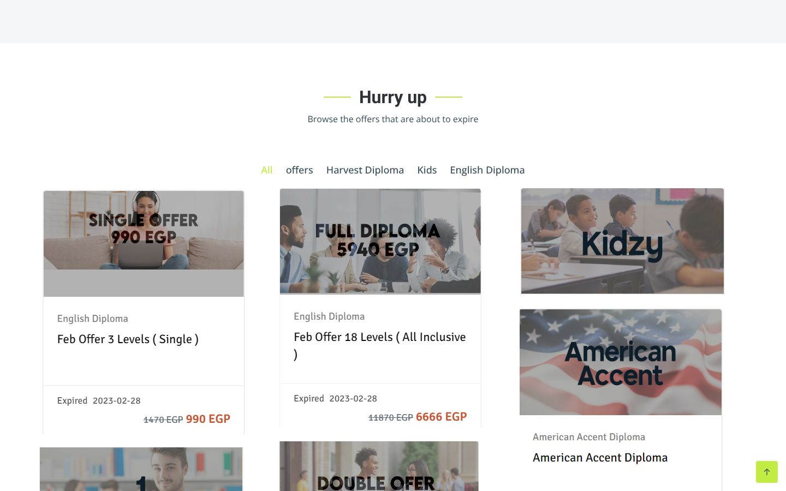

<div align="center">

# Harvest British College — Website v2

### One-page website for an English-language college · HTML · CSS · JavaScript · Bootstrap 5

The second, rebuilt version of the Harvest British College website, which I made while working at Harvest as a Front-End Developer (January–September 2023). It presents the college, its English and Kids diplomas with prices, current offers, the team and contact details on one responsive page.

[](https://developer.mozilla.org/docs/Web/HTML)
[](https://developer.mozilla.org/docs/Web/CSS)
[](https://developer.mozilla.org/docs/Web/JavaScript)
[](https://getbootstrap.com)
[](https://swiperjs.com)
[](https://isotope.metafizzy.co)
[](https://michalsnik.github.io/aos/)
<br>
[](https://eslamraafat1.github.io/HarvestNew/)
[](https://harvestcollege.co.uk/)

**[Live demo](https://eslamraafat1.github.io/HarvestNew/)** ·
**[First version (Harvest)](https://github.com/Eslamraafat1/Harvest)** ·
**[Portfolio](https://new-portfolio-ashy-xi.vercel.app/)** ·
**[LinkedIn](https://www.linkedin.com/in/eslamraafat-dev/)** ·
**[Email](mailto:eslamraafat736@gmail.com)**

<br>



</div>

<table>
  <tr>
    <td width="33%"></td>
    <td width="67%">
      <br><br>
      
    </td>
  </tr>
  <tr>
    <td align="center"><sub>Mobile (iPhone 13)</sub></td>
    <td align="center"><sub>Services with prices · "Hurry up" filterable offers</sub></td>
  </tr>
</table>

---

## Contents

- [Overview](#overview)
- [What changed from v1](#what-changed-from-v1)
- [Features](#features)
- [Tech stack](#tech-stack)
- [Page sections](#page-sections)
- [Project structure](#project-structure)
- [Getting started](#getting-started)
- [Known limitations](#known-limitations)
- [Deployment](#deployment)
- [Author](#author)

## Overview

**Client:** Harvest British College ([harvestcollege.co.uk](https://harvestcollege.co.uk/)), an English-language training college headquartered in Dokki, Giza, Egypt.
**My role:** Front-End Developer at Harvest (January–September 2023).
**Date of this build:** March 2023.

HarvestNew replaces the [first version](https://github.com/Eslamraafat1/Harvest) of the site. Instead of a React app with placeholder marketplace content, it is a lightweight static one-page site built on a Bootstrap 5 one-page template, restyled with the Harvest brand (lime accent colour, logo) and filled with the college's real content: who they are, their vision, curriculum notes, diploma prices, accreditation, offers, team and contact details.

## What changed from v1

| | **[Harvest](https://github.com/Eslamraafat1/Harvest) (v1)** | **HarvestNew (this repo, v2)** |
| --- | --- | --- |
| Date | February 2023 | March 2023 |
| Approach | React 18 single-page app (Create React App), only the production build committed | Static one-page site: plain HTML, CSS and vanilla JavaScript, no build step |
| Base | React scaffold reused from an earlier project; the landing page lives in the navbar component | [UpConstruction](https://bootstrapmade.com/) one-page template by BootstrapMade (credited in the footer, as its free licence requires; some section ids such as `constructions` are kept from the template) |
| Content | Course-marketplace layout with placeholder banners and copy | Real Harvest content: about, vision, curriculum, services with prices, Cambridge accreditation, team, address and phone numbers |
| Interactivity | Bootstrap carousels | Hero carousel, Isotope offer filters, Swiper team slider, AOS scroll animations, GLightbox image previews, validated enquiry form that opens an email to the college |
| Source in repo | Build output only | Full, readable source |

## Features

- **Full-screen hero carousel** (five slides, 5-second interval) with "Welcome to Harvest" and a **Get Started** button that scrolls to the next section.
- **Transparent header** over the hero with the Harvest logo, navigation and a mobile menu (hamburger toggle).
- **Services cards:** English Diploma (Level by Level, 490 EGP; True Beginners, 550 EGP; VIP, 2200 EGP) and Kidzy Diploma programmes, each with price.
- **"Hurry up" offers grid:** filterable with Isotope (All · offers · Harvest Diploma · Kids · English Diploma), showing expiry dates and old vs. new prices. Each card opens a GLightbox preview.
- **About tabs:** Cambridge Certificate, Our Gallery, Graduation, and Harvest Portfolio & Clients (Bootstrap tabs).
- **Harvest Team slider** (Swiper) with names and roles.
- **Enquiry form** with client-side validation (name, email, phone, message). Because GitHub Pages cannot run server code, a valid enquiry opens the visitor's email app addressed to `info@harvestcollege.co.uk`, with the details pre-filled.
- **Find Us** cards with working links (call 19545, open the address in Google Maps, send an email) and a footer with address, clickable phone numbers and email, and TikTok, Facebook, Instagram and LinkedIn links.
- **SEO basics:** descriptive title and meta description, canonical URL, Open Graph and Twitter card tags, and `EducationalOrganization` JSON-LD built from the contact details on the page.
- **Scroll animations** (AOS), a preloader and a scroll-to-top button.

## Tech stack

| Layer | Tools |
| --- | --- |
| Markup and styles | HTML5, CSS3 (`assets/css/main.css`, CSS custom properties for colours and fonts) |
| Framework | Bootstrap 5.2.3, Bootstrap Icons, Font Awesome Free 6.2.1 |
| JavaScript | Vanilla JS (`assets/js/main.js`) |
| Libraries | Swiper 8.4.5, Isotope 3.0.6, AOS, GLightbox, PureCounter |
| Fonts | Google Fonts: Roboto, Open Sans, Work Sans |
| Hosting | GitHub Pages |

## Page sections

| Anchor | Section |
| --- | --- |
| `#hero` | Hero carousel: "Welcome to Harvest" |
| `#get-started` | "Who are we?" and "Our Vision" with an enquiry form |
| `#constructions` | Curriculum |
| `#services` | Services: diplomas and prices |
| `#alt-services` | About Harvest, services, CEO word, why choose Harvest (links to the college's company profile PDF) |
| `#features` | Tabs: Cambridge Certificate, Gallery, Graduation, Portfolio & Clients |
| `#projects` | "Hurry up": filterable offers |
| `#testimonials` | Harvest Team slider |
| `#recent-blog-posts` | Find Us: contact, location, email |

## Project structure

```text
.
├── index.html                 # the whole one-page site
├── assets/
│   ├── css/main.css           # theme and custom styles
│   ├── js/main.js             # header, mobile nav, Isotope, Swiper, GLightbox, AOS setup
│   ├── img/
│   │   ├── edu/               # Harvest images (logo, diplomas, offers, team)
│   │   └── hero-carousel/     # hero slides
│   └── vendor/                # Bootstrap, Bootstrap Icons, Font Awesome, Swiper, Isotope, AOS, GLightbox, PureCounter
└── docs/screenshots/          # README images
```

## Getting started

No build step and no dependencies to install:

```bash
git clone https://github.com/Eslamraafat1/HarvestNew.git
cd HarvestNew
npx serve .        # or simply open index.html in a browser
```

There is no back end: the enquiry form validates in the browser and then opens a pre-filled email (`mailto:`) to the college.

## Known limitations

- **Snapshot of early 2023 content.** Prices and the February 2023 offers (marked as expired) are shown as the college published them at the time; they are not kept up to date.
- **No server-side form handling.** The enquiry form relies on the visitor having an email app; the phone numbers are shown next to it as an alternative.
- **Some copy is the college's own text, kept as written** (for example in the Curriculum and Cambridge Certificate sections).
- Template naming (`constructions`, `projects`, `recent-blog-posts` section ids and CSS classes) is kept so the BootstrapMade styles keep working.

## Deployment

Deployed with **GitHub Pages** from the `master` branch: [eslamraafat1.github.io/HarvestNew](https://eslamraafat1.github.io/HarvestNew/).

## Author

**Eslam Raafat** — Front-End Developer (React · Next.js · TypeScript)

- **Portfolio:** [new-portfolio-ashy-xi.vercel.app](https://new-portfolio-ashy-xi.vercel.app/)
- **LinkedIn:** [linkedin.com/in/eslamraafat-dev](https://www.linkedin.com/in/eslamraafat-dev/)
- **GitHub:** [@Eslamraafat1](https://github.com/Eslamraafat1)
- **Email:** [eslamraafat736@gmail.com](mailto:eslamraafat736@gmail.com)

---

© Harvest British College. Code shared for portfolio purposes. Template: [UpConstruction by BootstrapMade](https://bootstrapmade.com/), used under its free licence with the footer credit kept.
